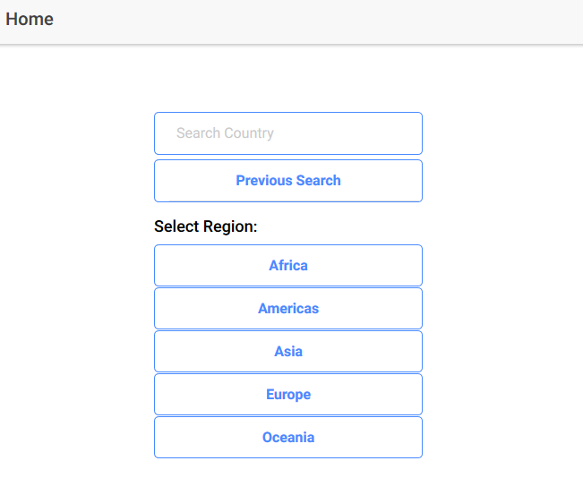
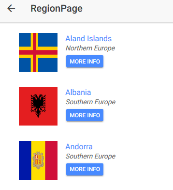
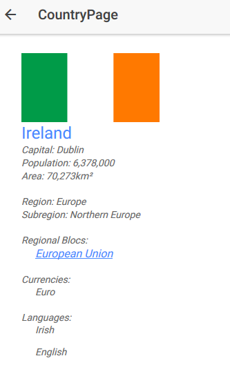

# Ionic Country Explorer

A mobile application built with Ionic 3 and Angular 5 that lets users explore country information using the [REST Countries API](https://restcountries.eu/).

## Features

- **Search by Name** — Enter a country name to view detailed information
- **Browse by Region** — Explore countries grouped by Africa, Americas, Asia, Europe, and Oceania
- **Country Details** — View flag, population, capital, languages, currencies, and regional blocs
- **Previous Search** — Quickly revisit the last country you searched for
- **In-App Browser** — Tap regional bloc links to read more on Wikipedia

## Screenshots

| Home | Region | Country |
|------|--------|---------|
|  |  |  |

## Tech Stack

- **Framework:** Ionic 3 (ionic-angular 3.9.3)
- **Language:** TypeScript 2.6
- **Angular:** 5.2.11
- **API:** [REST Countries](https://restcountries.eu/)
- **Native Plugins:** Cordova InAppBrowser

## Getting Started

### Prerequisites

- Node.js (v8+)
- npm
- Ionic CLI (`npm install -g ionic@3`)
- Cordova (`npm install -g cordova`)

### Installation

```bash
git clone https://github.com/<your-username>/ionic-country-explorer.git
cd ionic-country-explorer
npm install
```

### Run in Browser

```bash
ionic serve
```

### Run on Device

```bash
ionic cordova run android
# or
ionic cordova run ios
```

## Project Structure

```
src/
├── app/              # Root module and component
├── pages/
│   ├── home/         # Search and region navigation
│   ├── region/       # List of countries in a region
│   └── country/      # Detailed country view
├── providers/
│   └── country-api/  # HTTP service for REST Countries API
├── assets/           # Static assets
└── theme/            # Global Ionic theme variables
```

## License

This project is provided as-is for educational purposes.
